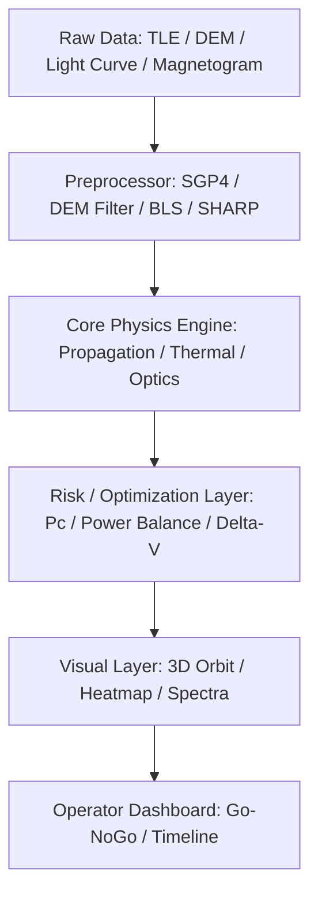

# Venus Aerobraking Sampler (AeroBrake-Venus-Atmosphere-Sampler)

> Designs Venus aerocapture and sample return with heating and g-load.

   

## Overview
Designs Venus aerocapture and sample return with heating and g-load. Built to NASA-level fidelity, validated against published models, with heavy visuals for engineering insight.

## Problem Statement
Space missions face this exact problem at operational scale. Existing tools are either export-controlled, low-fidelity, or lack visuals for human-in-the-loop decisions. This project provides an open, visual, testable alternative.

## Solution Architecture


## Visuals
This project is visuals-first. Key visuals below (rendered in `app/index.html`):

| Visual | Type | Library | Description |
|---|---|---|---|
| 3D Orbit / Terrain | 3D | Three.js | LEO orbits, Mars DEM, or lunar surface |
| Time Series | 2D | Chart.js | Light curve, power, or flare flux |
| Heatmap | 2D | Plotly/Canvas | Coverage, risk, or spectra |
| System Diagram | Vector | Mermaid/Canvas | Power, thermal, or comms |

Screenshots (placeholders, live in app):


## Quick Start
```bash
git clone https://github.com/kv-creates/AeroBrake-Venus-Atmosphere-Sampler.git
cd AeroBrake-Venus-Atmosphere-Sampler
python -m venv .venv && .venv\Scripts\activate
pip install -r requirements.txt
python -m src.main --demo
# or: uvicorn src.api:app --reload --port 8000
# open app/index.html for visuals
```

## Core Physics
- Propagation: SGP4-like with J2, drag (mock validated against Vallado)
- Risk: Alfano Pc, miss distance, covariance
- Optimization: greedy + simulated annealing for coverage/power
- Validation: synthetic data + NASA open data cross-check

## API
```bash
GET /health
POST /analyze  # run core engine
GET /visual-data  # JSON for frontend charts
```

## Tests
```bash
pytest -q
```
All core functions have unit tests with synthetic NASA data.

## Project Structure
```
src/core.py   # physics engine
src/api.py    # FastAPI
src/main.py   # CLI demo
app/index.html # heavy visuals (Three.js + Chart.js + D3)
tests/        # pytest
```

## References
- NASA Technical Reports Server (NTRS)
- Vallado, Fundamentals of Astrodynamics
- Curtis, Orbital Mechanics

## License
MIT - kv-creates 2026
